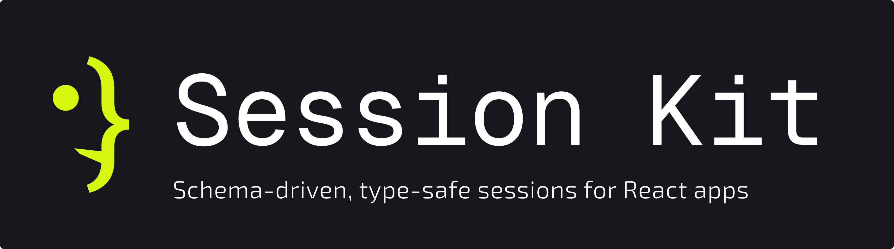

[](https://www.npmjs.com/package/@monarcode/session-kit)
[](https://github.com/monarcode/session-kit/actions/workflows/ci.yml)
[](https://bundlejs.com/?q=@monarcode/session-kit&treeshake=%5B%7BcreateAuth%2CwebStorage%7D%5D)
[](https://www.npmjs.com/package/@monarcode/session-kit)
[](https://www.npmjs.com/package/@monarcode/session-kit#provenance)
[](./LICENSE)

[](https://session-kit.monarcode.dev/docs/getting-started)
[](https://session-kit.monarcode.dev/docs/setups/tanstack-router)
[](https://session-kit.monarcode.dev/docs/setups/tanstack-start)
[](https://session-kit.monarcode.dev/docs/setups/react-router)
[](https://session-kit.monarcode.dev/docs/setups/next)
[](https://session-kit.monarcode.dev/docs/setups/expo)
[](https://session-kit.monarcode.dev/docs/effect)

**Every sign-in ends in a session. Make yours type-safe and predictable.**

Session kit is the session layer for React apps that have their own backend.
Give it the tokens your sign-in endpoint returns, and it saves the session,
restores it on reload, refreshes tokens before they expire, keeps every tab in
sync, and guards your routes. It never signs users in: your backend does, and
Session kit takes over from its response.

It works with TanStack Router, React Router, and Expo Router, renders on the
server with TanStack Start, Next.js, and React Router, and comes with an
[Effect](https://effect.website) service and an
[effetch](https://github.com/monarcode/effetch) plugin.

> **Release candidate.** The API is frozen for 0.1, and later 0.1 releases
> only add to it. See the [release notes](./CHANGELOG.md).

**Documentation: [session-kit.monarcode.dev](https://session-kit.monarcode.dev)**

## Installation

Install the package and a schema library:

```sh
npm install @monarcode/session-kit zod
```

Any [Standard Schema](https://standardschema.dev) library describes users.
The examples use Zod. Peer dependencies such as React and your router are
optional: install the ones your setup uses. Session kit needs TypeScript 5.4
or newer (Effect asks for 5.9), and
[Compatibility](https://session-kit.monarcode.dev/docs/reference/compatibility)
lists the supported versions.

Release candidates are published to the `latest` tag, so pin an exact version
and read the [release notes](./CHANGELOG.md) before upgrading.

## Quick start

Your backend keeps its sign-in and refresh endpoints. Session kit takes the
tokens they return and manages the session from there. A React app needs
three files, plus your own sign-in form.

**1. Create the client.** It checks every user against your schema, saves the
session, and calls your `refresh` before the access token expires:

<!-- file: src/auth.ts -->

```ts
import { createAuth, webStorage } from "@monarcode/session-kit";
import { z } from "zod";

export const auth = createAuth({
  // Keeps this app's saved session apart from others on the same origin.
  name: "my-app",
  // Every user is checked against this schema, and typed by it.
  user: z.object({ id: z.string(), name: z.string() }),
  // Saves the session in localStorage, so it survives reloads.
  storage: webStorage(),
  refresh: async ({ refreshToken, signal }) => {
    const response = await fetch("/api/auth/refresh", {
      method: "POST",
      headers: { "Content-Type": "application/json" },
      body: JSON.stringify({ refreshToken }),
      signal,
    });
    if (response.status === 401) return null; // rejected: sign out
    if (!response.ok) throw new Error(`Refresh failed (${response.status})`);
    return response.json();
  },
});

// Types the React hooks with this client's user.
declare module "@monarcode/session-kit" {
  interface Register {
    auth: typeof auth;
  }
}
```

**2. Sign in.** Pass `signIn` what your backend's sign-in returned, the tokens
and the user:

<!-- file: src/sign-in.ts -->

```ts
import { auth } from "./auth.js";

export async function signIn(email: string, password: string) {
  const response = await fetch("/api/auth/login", {
    method: "POST",
    headers: { "Content-Type": "application/json" },
    body: JSON.stringify({ email, password }),
  });
  if (!response.ok) throw new Error(`Sign-in failed (${response.status})`);
  // { accessToken, refreshToken, expiresIn, user }
  const tokens = await response.json();
  await auth.signIn(tokens);
}
```

**3. Render by the session's status.** `useAuth` re-renders when it changes,
in this tab or another:

<!-- file: src/app.tsx -->

```tsx
import {
  AuthProvider,
  useAuth,
  useAuthClient,
} from "@monarcode/session-kit/react";

import { auth } from "./auth.js";
import { SignInForm } from "./sign-in-form.js"; // your form, calling signIn

export function App() {
  return (
    <AuthProvider client={auth}>
      <Home />
    </AuthProvider>
  );
}

function Home() {
  const session = useAuth();
  const client = useAuthClient();

  if (session.status === "initializing") return <p>Restoring your session…</p>;
  if (session.status === "unauthenticated") return <SignInForm />;
  if (session.status === "unavailable") {
    // The session couldn't be restored or refreshed, say while offline.
    return (
      <button onClick={() => client.retry().catch(console.error)}>
        Try again
      </button>
    );
  }
  return (
    <main>
      <h1>Welcome, {session.user.name}</h1>
      <button onClick={() => client.signOut().catch(console.error)}>
        Sign out
      </button>
    </main>
  );
}
```

To call your API, `createAuthFetch` from `@monarcode/session-kit/http` adds
the access token to each request and refreshes it after a 401.
[Getting started](https://session-kit.monarcode.dev/docs/getting-started) builds
this app step by step against a real test backend, and the setup guides add
your router's guards or server rendering.

## Pick your setup

Each setup, from plain React to Next.js, Expo Router and Effect, has a guide:
see [Pick your setup](https://session-kit.monarcode.dev/docs/installation#pick-your-setup).
Every setup but plain React has a runnable app in [`examples/`](./examples).

## Contributing

See [CONTRIBUTING.md](./CONTRIBUTING.md).

## License

[MIT](./LICENSE)
