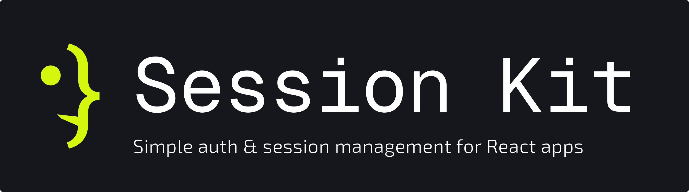

[](https://www.npmjs.com/package/@monarcode/session-kit)
[](https://github.com/monarcode/session-kit/actions/workflows/ci.yml)
[](https://bundlejs.com/?q=@monarcode/session-kit)
[](https://bundlejs.com/?q=@monarcode/session-kit&treeshake=%5B%7BcreateAuth%2CwebStorage%7D%5D)
[](https://www.npmjs.com/package/@monarcode/session-kit#provenance)
[](./LICENSE)

[](https://session-kit.pages.dev/docs/getting-started)
[](https://session-kit.pages.dev/docs/setups/tanstack-router)
[](https://session-kit.pages.dev/docs/setups/tanstack-start)
[](https://session-kit.pages.dev/docs/setups/react-router)
[](https://session-kit.pages.dev/docs/setups/next)
[](https://session-kit.pages.dev/docs/setups/expo)
[](https://session-kit.pages.dev/docs/effect)

**Your backend signs users in. session-kit handles everything after.**

session-kit is the session layer for React apps that have their own backend.
Hand it the tokens your sign-in endpoint returns, and it saves the session,
restores it on reload, refreshes tokens before they expire, keeps every tab in
step, and guards your routes.

It works with TanStack Router, React Router, and Expo Router, renders on the
server with TanStack Start, Next.js, and React Router, and comes with an
[Effect](https://effect.website) service and an
[effetch](https://github.com/monarcode/effetch) plugin.

> **Alpha.** Early development: the API may change between releases, and it
> isn't ready for production. See the [release notes](./CHANGELOG.md).

**Documentation: [session-kit.pages.dev](https://session-kit.pages.dev)**

## Installation

```sh
pnpm add @monarcode/session-kit
```

Alpha releases are published to the `latest` distribution tag and may change
the public API, so pin an exact version and read the
[release notes](./CHANGELOG.md) before upgrading.

Any [Standard Schema](https://standardschema.dev) library describes users.
The examples use Zod:

```sh
pnpm add zod
```

Every peer dependency is optional: install React and the router your setup
uses. [Compatibility](https://session-kit.pages.dev/docs/reference/compatibility) lists the
supported versions.

## Quick start

session-kit never calls your backend. Write the requests you'd write anyway:
one that signs in, and one that exchanges a refresh token for new tokens.

<!-- from: site/content/docs/(latest)/getting-started.mdx -->

```ts
/** Checks the password, and resolves the tokens and the user. */
export async function login(username: string, password: string) {
  const response = await post("/auth/login", { username, password });
  if (!response.ok) throw new Error(`Sign-in failed (${response.status})`);
  // DummyJSON returns the user's fields beside the tokens.
  const body: unknown = await response.json();
  return { ...tokensSchema.parse(body), user: userSchema.parse(body) };
}

/**
 * Exchanges a refresh token for new tokens. Resolves `null` when the backend
 * rejects the token, and throws for any other failure.
 */
export async function refresh(refreshToken: string, signal: AbortSignal) {
  const response = await post("/auth/refresh", { refreshToken }, { signal });
  // DummyJSON answers 403 for an invalid token and 401 for a missing one.
  if (response.status === 401 || response.status === 403) return null;
  if (!response.ok) throw new Error(`Refresh failed (${response.status})`);
  return tokensSchema.parse(await response.json());
}
```

Then create the client. It saves the session, restores it on reload, and
refreshes the tokens with your `refresh`:

<!-- from: site/content/docs/(latest)/getting-started.mdx -->

```ts
export const auth = createAuth({
  // Keeps this app's saved session apart from any other on the same origin.
  name: "my-app",
  // Every user is checked against this schema, and typed by it.
  user: userSchema,
  // Where the session is saved: `localStorage`.
  storage: webStorage(),
  // How expired access is replaced.
  refresh: ({ refreshToken, signal }) => refresh(refreshToken, signal),
});
```

And render by the session's status:

<!-- from: site/content/docs/(latest)/getting-started.mdx -->

```tsx
function Screen() {
  const { status, user } = useAuth();
  const client = useAuthClient();

  switch (status) {
    case "initializing":
      return <p>Restoring your session…</p>;
    case "unauthenticated":
      return <SignIn />;
    case "unavailable":
      // Access couldn't be restored or refreshed: offer another try.
      return (
        <button onClick={() => void client.retry().catch(() => {})}>
          Try again
        </button>
      );
    default:
      // Signed in: "authenticated", or "refreshing" with the user on screen.
      return (
        <main>
          <h1>Welcome, {user.firstName}</h1>
          <button onClick={() => void client.signOut().catch(() => {})}>
            Sign out
          </button>
        </main>
      );
  }
}
```

[Getting started](https://session-kit.pages.dev/docs/getting-started) builds this into a working app
one step at a time, against a real test backend.

## Pick your setup

| Setup                                           | Guide                                                                               |
| ----------------------------------------------- | ----------------------------------------------------------------------------------- |
| React without a router                          | [Getting started](https://session-kit.pages.dev/docs/getting-started)               |
| TanStack Router, and TanStack Start in SPA mode | [TanStack Router](https://session-kit.pages.dev/docs/setups/tanstack-router)        |
| TanStack Start with server rendering            | [TanStack Start](https://session-kit.pages.dev/docs/setups/tanstack-start)          |
| React Router: declarative, data, framework mode | [React Router](https://session-kit.pages.dev/docs/setups/react-router)              |
| React Router, framework mode with SSR           | [React Router with SSR](https://session-kit.pages.dev/docs/setups/react-router-ssr) |
| Next.js 16, App Router                          | [Next.js](https://session-kit.pages.dev/docs/setups/next)                           |
| Expo Router on iOS and Android, SDK 53+         | [Expo Router](https://session-kit.pages.dev/docs/setups/expo)                       |
| Effect and effetch, with any of the above       | [Effect and effetch](https://session-kit.pages.dev/docs/effect)                     |

Each has a runnable app in [`examples/`](./examples).

## Contributing

See [CONTRIBUTING.md](./CONTRIBUTING.md).

## License

[MIT](./LICENSE)
